<div align="center">

<!-- A README is sandboxed by GitHub (Content-Security-Policy: default-src
     'none'; sandbox) and images are embedded through its camo proxy, so the
     banner carries no JavaScript: the particle motion is precomputed and baked
     into SMIL by scripts/gen-banner.js. -->


<br/><br/>

[](https://www.linkedin.com/in/esmeAbha)
&nbsp;
[](mailto:esmechowdhuryabha@gmail.com)
&nbsp;
[](https://esme.framer.ai)
&nbsp;
[](https://github.com/EsmeAbha)

</div>

<br/>

## Hey there! I'm Abha 👋

**Backend Engineer & AI Tools Builder** · Dhaka, Bangladesh · she/her

I'm a Software Engineer at **Odin Outsourcing**, previously backend at **Byteverse Ltd**. I care about
the unglamorous half of software — the services, pipelines and jobs that quietly hold a product up
while nobody looks at them.

Most of what I build starts as someone doing something tedious by hand. I'm drawn to the moment a
manual process becomes a script, then an API, then something that just runs. My day-to-day work is
**Laravel** and **Python**, and it lives in private repos; what's public here leans toward data work
in **R** and **Jupyter**, plus **TypeScript** side projects. Currently going deeper on cloud
infrastructure and distributed systems.

<br/>

```console
$ whoami
abha — software engineer @ odin outsourcing

$ cat ~/.philosophy
if a human is doing it twice, it should be a script.

$ echo $NOW
learning: cloud infrastructure & distributed systems
```

<br/>

## Featured projects

| Project | What it shows |
|---|---|
| [`oncall-agent`](https://github.com/EsmeAbha/oncall-agent) | Alert triage that gathers cited evidence from Prometheus and Kubernetes, and auto-remediates (rollback, scale) only under guards: kill switch, cooldown, hourly budget, Lease leader election, least-privilege RBAC checked in CI |
| [`gke-gitops-dr`](https://github.com/EsmeAbha/gke-gitops-dr) | Two-region Postgres on GKE via Argo CD and Terraform; failover is a reviewed PR, and DR drills measure RPO/RTO on every CI run |
| [`k8s-slo-service`](https://github.com/EsmeAbha/k8s-slo-service) | A service run SRE-style: Helm, burn-rate SLO alerts tested with promtool, error-budget dashboard, runbook, and an Envoy edge drill where 0 of 750 requests failed with one of three instances broken |
| [`netprobe`](https://github.com/EsmeAbha/netprobe) | Go tool that splits a request into DNS → TCP → TLS → TTFB and watches certificate expiry; CLI plus Prometheus exporter |
| [`aws-auto-remediation`](https://github.com/EsmeAbha/aws-auto-remediation) | Self-healing ECS Fargate service in Terraform: EventBridge, Lambda, SQS, DynamoDB, SNS |

<br/>


## How I build things

```mermaid
%%{init: {'theme':'base','themeVariables':{
  'primaryColor':'#12111d','primaryTextColor':'#CECBF6','primaryBorderColor':'#3a3552',
  'lineColor':'#544e78','secondaryColor':'#1a1926','tertiaryColor':'#0f0e18',
  'edgeLabelBackground':'#0b0a12',
  'fontFamily':'ui-monospace, SFMono-Regular, Menlo, monospace','fontSize':'13px'}}}%%
flowchart LR
    A["a process still<br/>run by hand"]
    B["map the steps,<br/>pin down the contract"]
    C["shape the data<br/>python · pandas"]
    D["expose a service<br/>laravel · flask"]
    E["an interface, only where a<br/>human stays in the loop<br/>next.js · tailwind"]
    F[("persistence")]
    G["scheduled work<br/>queues · workers · cron"]
    H["observability<br/>logs · retries · alerts"]
    I["runs unattended"]

    A --> B
    B --> C
    B --> D
    B --> E
    C --> F
    D --> F
    E --> D
    F --> G
    G --> H
    H --> I
    H -. "what production teaches" .-> B

    classDef ends fill:#191320,stroke:#D4537E,stroke-width:1.5px,color:#F2D6E2
    classDef step fill:#12111d,stroke:#7F77DD,stroke-width:1.2px
    classDef store fill:#12111d,stroke:#4d9c8b,stroke-width:1.2px,color:#BFE6DA
    class A,I ends
    class B,C,D,E,G,H step
    class F store
```




## Stack

<div align="center">



</div>

<sub>
One self-hosted asset from <a href="scripts/gen-stack.js">scripts/gen-stack.js</a> rather than fourteen
badge requests — same reasoning as the chart below, and it keeps the type and palette matched to it.
</sub>


## By the numbers

<div align="center">



</div>

<sub>
Generated straight from the GitHub API by
<a href="scripts/gen-langs.sh">scripts/gen-langs.sh</a> and refreshed weekly by
<a href=".github/workflows/refresh-stats.yml">a workflow</a> — no third-party card service, so it
cannot rate-limit or go down. It counts <em>repositories</em> rather than bytes on purpose:
<code>.ipynb</code> files embed their own outputs, so byte-counting reports ~90% "Jupyter Notebook"
for this account, which describes the file format rather than the work.
</sub>

<br/><br/>

<div align="center">

<sub><code>$ exit</code> &nbsp;·&nbsp; thanks for stopping by</sub>

<br/><br/>


</div>
